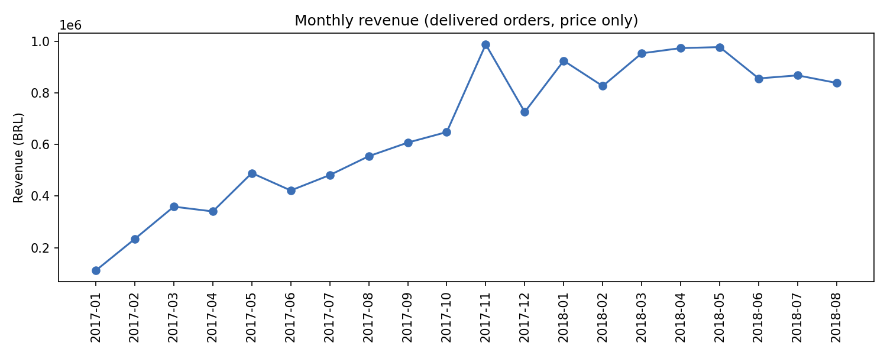
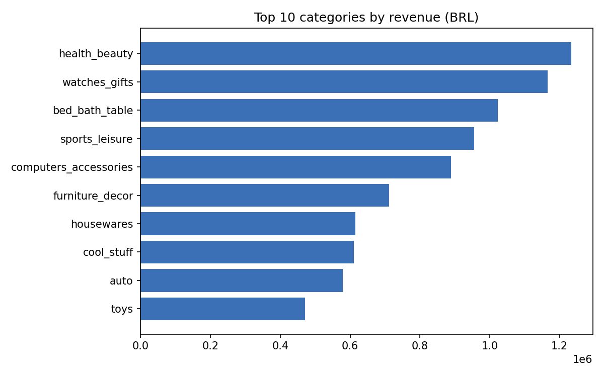
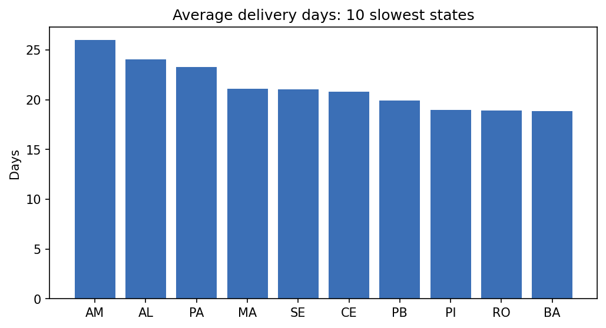
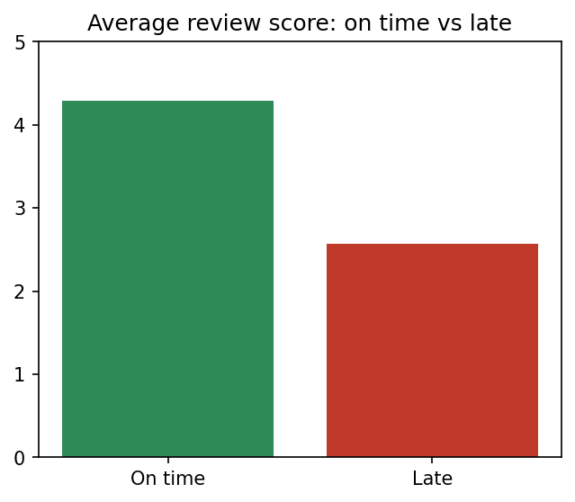
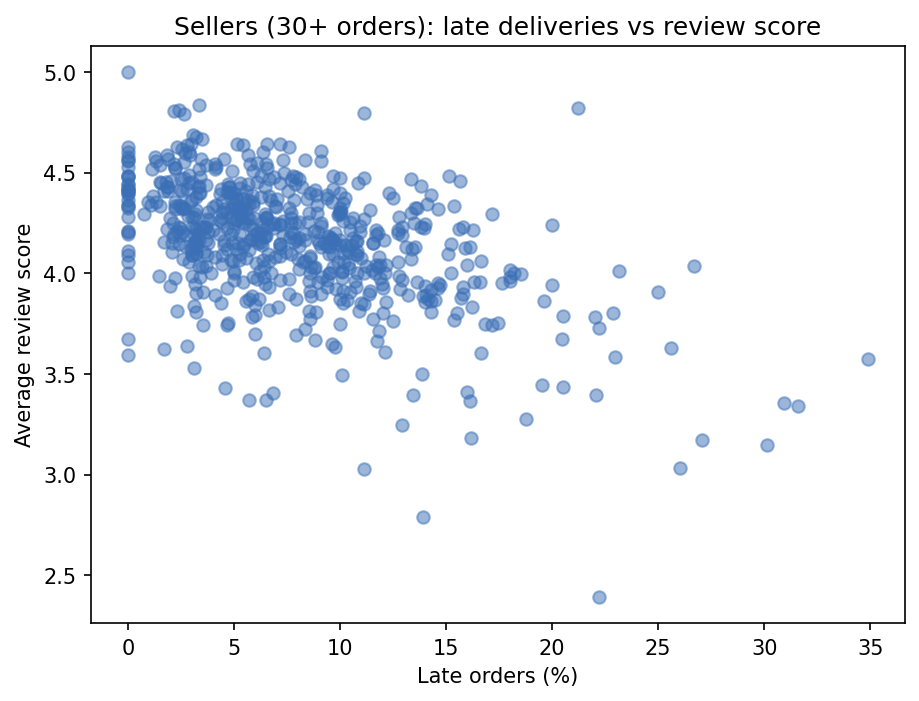

# Olist E-commerce Performance Analysis

An end-to-end e-commerce analytics project using the **Brazilian E-Commerce Public Dataset by Olist**. The project combines Python, SQL, SQLite, and Power BI to examine sales performance, delivery reliability, customer reviews, seller performance, and payment behaviour.

## Business questions

- How much product revenue did delivered orders generate, and how did it change over time?
- Which product categories and Brazilian states contributed the most revenue?
- How long did customers wait for their orders, and where were delivery times longest?
- How strongly were late deliveries associated with lower review scores?
- How did seller-level delivery performance relate to customer ratings?
- What do the available customer-repeat and payment-installment patterns show?

## Key findings

| Area | Finding |
|---|---|
| Delivered orders | 96,478 orders with `order_status = delivered`; 96,470 have valid customer-delivery timestamps for delivery analysis |
| Product revenue | R$13,221,498.11 based on item price; freight is excluded |
| Average order value | R$137.04, calculated as product revenue divided by delivered orders |
| Delivery time | 12.56 days on average; median 10.22 days |
| Customer reviews | Average review score was 2.57 for late deliveries versus 4.29 for on-time deliveries |
| Seller performance | Across the 627 sellers with at least 30 eligible orders, late-delivery rate and average review score had a correlation of approximately -0.509 |

The delivery/review and seller-level relationships are **associations, not proof of causation**. Other factors may influence customer ratings.

## Additional customer, product, and payment insights

- **Customers:** Among delivered orders with valid customer-delivery timestamps, 93,350 distinct customers were observed. 90,549 (97.0%) had one delivered order, while 2,801 (3.0%) had at least two. This indicates limited repeat purchasing in the observed dataset; it is not a full retention or cohort analysis.
- **Products:** 32,216 distinct products appeared in delivered orders. 17,716 (55.0%) appeared in exactly one `order_items` row. This is a count of order-item records, not distinct orders. The top 322 products by product revenue contributed approximately 24.45% of total product revenue.
- **Credit-card payments:** Across all payment records and order statuses, 51,338 of 76,795 credit-card payment records (66.9%) used more than one installment. The average was approximately 3.5 installments. This payment analysis is not restricted to delivered orders.

## Tools and methods

- **Python:** pandas, NumPy, Matplotlib
- **SQL / SQLite:** business queries and structured analysis across eight related tables
- **Power BI:** interactive report with overview, delivery, and seller analysis pages
- **Data preparation:** date parsing, joins, aggregation, data-quality checks, fact-table exports, and category translation

## Project files

| File | Description |
|---|---|
| `olist_analysis.ipynb` | Python analysis notebook; reads from the SQLite database downloaded separately |
| `olist.db` (external download) | Not stored in this repository. [Download the database ZIP from Google Drive](https://drive.google.com/file/d/1jBK-HqWCnZspD0rD-l5k0R1762SV7-0y/view?usp=sharing), extract it, and place `olist.db` beside the notebook |
| `olist_dashboard.pbix` | Power BI report |
| `orders_fact.csv` | Order-level fact table for Power BI |
| `items_fact.csv` | Order-item-level fact table for Power BI |
| `seller_performance.csv` | Seller delivery and review performance summary |
| `monthly_revenue.csv` | Monthly delivered-order product revenue |
| `revenue_by_category.csv` | Product revenue by category |
| `delivery_by_state.csv` | Delivery performance by customer state |
| `monthly_revenue.png` | Monthly revenue trend |
| `top_categories.png` | Top product categories by revenue |
| `slowest_states.png` | States with the longest average delivery times |
| `score_late_vs_ontime.png` | Review-score comparison by delivery status |
| `seller_late_vs_score.png` | Seller-level late-delivery and review-score relationship |

## Visual results

The notebook generates the following charts:

### Monthly product revenue


### Top product categories


### Delivery performance by state


### Review scores by delivery timeliness


### Seller delivery performance and review scores


## Reproducibility and quality checks

The notebook was executed against the supplied SQLite database in a clean working folder. All analysis steps completed without execution errors and regenerated the expected CSV tables and chart files.

- Source database: 99,441 orders; 8 delivered orders have no customer-delivery timestamp.
- Delivery analysis: 96,470 eligible delivered orders; average delivery time 12.56 days and median 10.22 days.
- SQL cross-check: 96,478 delivered orders, R$13,221,498.11 in product revenue, and R$137.04 average order value.
- Review cross-check: 7,661 late reviewed orders averaged 2.57/5; 88,163 on-time reviewed orders averaged 4.29/5.
- The SQL checks use an in-memory SQLite database, leaving the original `olist.db` unchanged.
- The PBIX package was checked for archive integrity and contains three pages: Overview, Delivery, and Sellers. Relationship behaviour and interactive slicers still need final verification in Power BI Desktop.

## Run locally

1. Clone or download this repository.
2. Download the SQLite database ZIP using the Google Drive link in the **Project files** section and extract it.
3. Place the extracted `olist.db` file in the same folder as `olist_analysis.ipynb`.
4. Install dependencies:

   ```bash
   pip install -r requirements.txt
   ```

5. Open `olist_analysis.ipynb` in Jupyter Notebook or JupyterLab.
6. Run all cells from top to bottom.

The notebook regenerates the summary CSV files and charts in the project folder.

## Power BI model

The report is provided as `olist_dashboard.pbix`. The intended model uses `orders_fact` at the order grain and `items_fact` at the order-item grain. The relationship should be one-to-many from `orders_fact[order_id]` to `items_fact[order_id]`. Review the relationship and test report slicers after opening the file in Power BI Desktop; this repository does not claim that every local Power BI interaction has been independently verified in this environment.

## Data source and license

Dataset: [Brazilian E-Commerce Public Dataset by Olist](https://www.kaggle.com/datasets/olistbr/brazilian-ecommerce), covering approximately 100,000 orders from 2016–2018. The dataset is anonymised and was published by Olist on Kaggle. The dataset is licensed under **Creative Commons Attribution-NonCommercial-ShareAlike 4.0 International (CC BY-NC-SA 4.0)**. Any redistribution or adaptation of the dataset and derived data files must follow the dataset's license. See the original Kaggle page for the license terms and attribution requirements.

## Scope and limitations

- Product revenue is calculated from item `price` and does not include freight charges.
- The customer-repeat figures describe observed delivered orders in this dataset; they should not be interpreted as a complete customer lifetime-value or retention model.
- The 55.0% product figure is based on the number of `order_items` rows per product, not the number of distinct orders.
- Payment-installment figures cover all payment records and order statuses unless otherwise stated.
- Correlation does not establish causation.
- The dataset covers historical transactions from 2016–2018 and should not be interpreted as a view of current market conditions.
